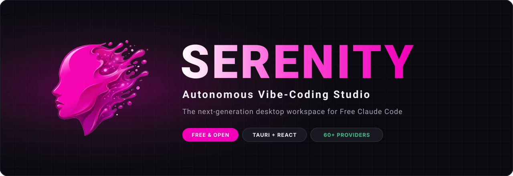
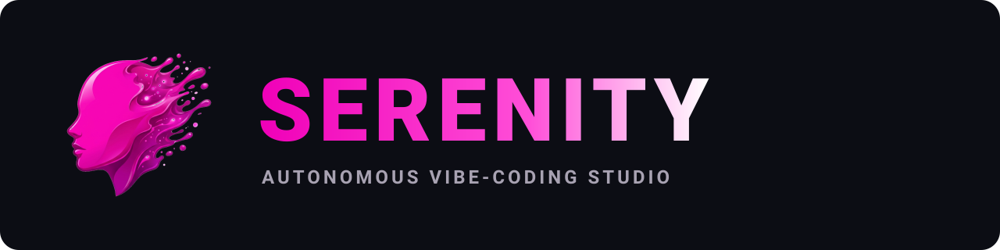

<div align="center">



<br/>

[](#)
[](https://tauri.app/)
[](https://vitejs.dev/)
[](https://tailwindcss.com/)
[](../free-claude-code/LICENSE)

<br/>

**Serenity** is an autonomous vibe-coding desktop studio built on top of [Free Claude Code](../free-claude-code/).  
It combines an ultra-fast native desktop shell with autonomous agent workflows, live multi-tab terminal multiplexing, an embedded web/app preview engine, git stage/commit controls, and redline performance benchmarking.

<br/>

[Quick Start](#quick-start) • [Features](#key-features) • [Brand Kit](BRANDING.md) • [Architecture](#architecture)

</div>

---

## Key Features

- **Autonomous Agent Control & Elevation:** Run AI coding agents with configurable autonomy modes (`Normal`, `Redline`, `YOLO`) with emergency stop triggers and elevation safeguards. Prompts are streamed to the CLI over stdin, so no shell ever interprets them.
- **Conversations that survive restarts:** Every exchange is stored per project and grouped into conversations; reopen any of them from the history menu and the agent resumes the same Claude session.
- **Embedded Web & Dev Server Preview:** Serve the project folder with the built-in static server (auto-reloads when files change, click-to-select any element and hand it to the agent) or detect running dev servers (Vite, Next.js, Astro, Storybook, FastAPI, Flask…) with their page titles.
- **PTY Terminal Multiplexer:** Native pseudo-terminals backed by `portable-pty` and `@xterm/xterm`, using your platform shell (PowerShell, zsh, bash), resizing with the panel and staying alive when you switch tabs.
- **Code Editor:** CodeMirror with syntax highlighting for TS/JS/CSS/HTML/JSON/Markdown/Python/Rust, `Ctrl/⌘+S` to save, and live reload when the agent edits the open file (with conflict protection for unsaved edits).
- **Native Git Integration:** Stage, unstage, discard, commit, diff (including untracked files and fresh repositories), and branch management without leaving the workspace.
- **Memory & Context Cache:** Local SQLite store (`fcc-studio.db`) for project instructions, agent learnings, conventions and decisions, injected into every run.
- **Redline Engine & Local Models:** Ollama model management with hardware detection, a verified benchmark suite with live per-task progress, a persisted leaderboard, and one-click local-only routing that restores your previous cloud config when switched off.
- **Remembers your workspace:** Panel sizes, open panels, the active tab and the last project are restored on launch.

---

## Quick Start

### Prerequisites

- [Node.js](https://nodejs.org/) (v18+)
- [Rust](https://www.rust-lang.org/tools/install) (stable toolchain with Cargo)
- [Free Claude Code](../free-claude-code/) with `fcc-claude` on your `PATH`
- Windows: [Microsoft C++ Build Tools](https://visualstudio.microsoft.com/visual-cpp-build-tools/)
- macOS: Xcode Command Line Tools (`xcode-select --install`)
- Linux: WebKitGTK and friends, e.g. on Debian/Ubuntu:

```bash
sudo apt-get install libwebkit2gtk-4.1-dev libgtk-3-dev librsvg2-dev libsoup-3.0-dev libayatana-appindicator3-dev
```

### Development

```bash
cd fcc-studio
npm install
npm run tauri dev
```

### Checks

```bash
npm run typecheck
```

```bash
npm test
```

```bash
npm run test:rust
```

End-to-end tests drive the compiled desktop app through WebDriver (`tauri-driver` + WebKitWebDriver on Linux) against the real Rust backend: file tree, editor live reload, preview server, git, terminal, memory, agent streaming and session resume, and layout persistence. The agent CLI is replaced by a stream-json fixture in `e2e/fixtures` so runs are deterministic and offline.

```bash
npx tauri build --debug --no-bundle
```

```bash
xvfb-run -a npm run test:e2e
```

### Production Build

```bash
npm run tauri build
```

Installers are written to `src-tauri/target/release/bundle/` (NSIS/MSI on Windows, DMG/app on macOS, deb/AppImage on Linux). CI builds and tests all three platforms on every push.

### Keyboard shortcuts

| Shortcut | Action |
| --- | --- |
| `Enter` / `Shift+Enter` | Send prompt / newline |
| `↑` in an empty prompt | Recall previous prompt |
| `Esc` | Stop the running agent |
| `Ctrl/⌘+Shift+N` | New conversation |
| ``Ctrl/⌘+` `` | Open the terminal |
| `Ctrl/⌘+S` | Save in the editor or skill editor |

---

## Design System & Brand Identity

Serenity follows the **Electric Fuchsia** design system. Read the complete visual identity guidelines, logo anatomy, color tokens, and icon usage in [BRANDING.md](BRANDING.md).

<div align="center">
  
  <br/><br/>
  <p>Crafted with 💖 by <b>snapwave//Lushapps</b></p>
</div>
